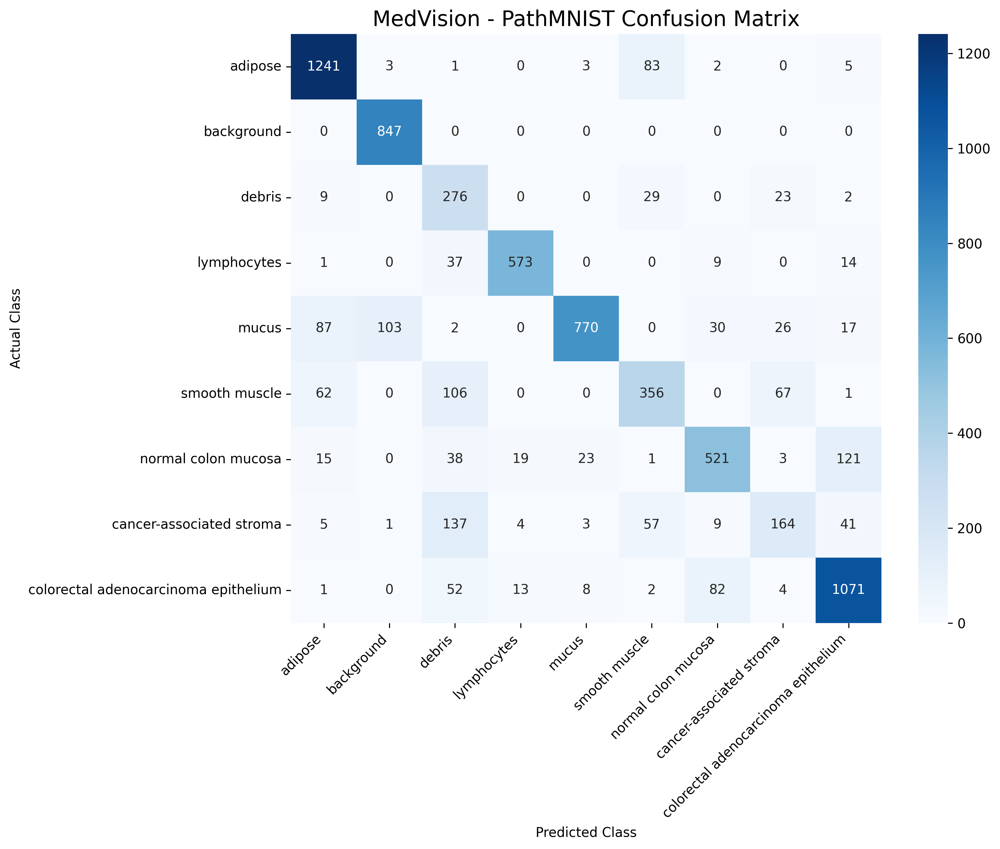
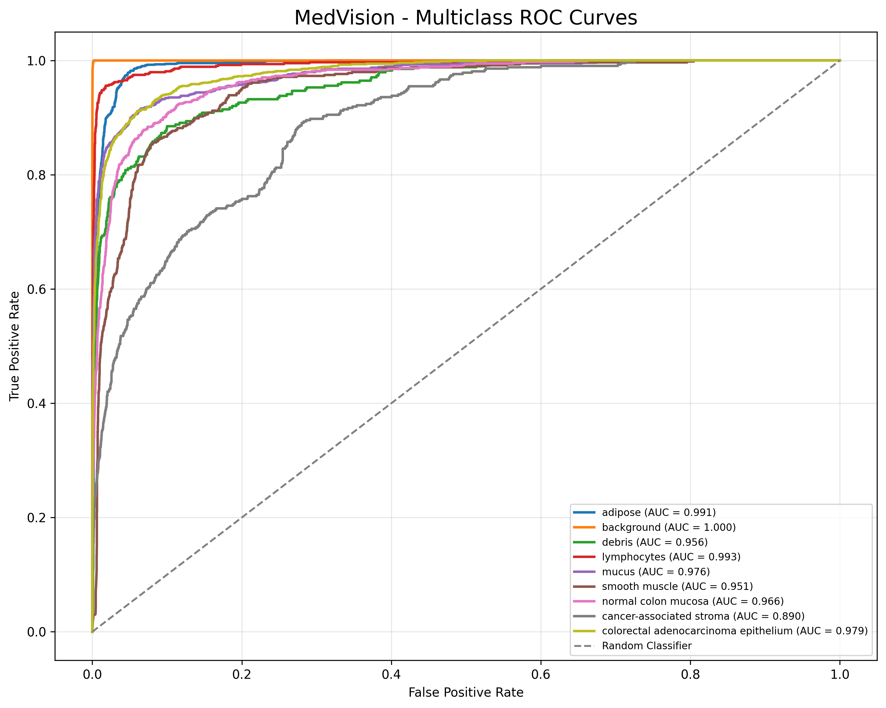
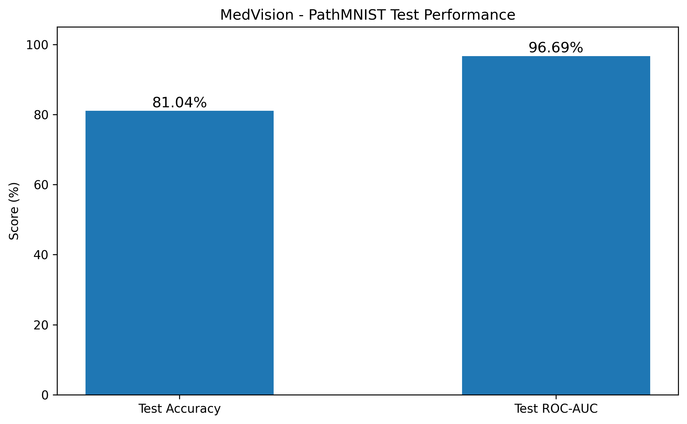

# MedVision
### Complex-Valued MLP-Mixer for Histopathological Image Classification

MedVision is a deep learning project exploring **complex-valued neural networks and MLP-Mixer architectures** for medical image classification. It implements a complex-valued mixing framework that processes real and imaginary feature representations to classify histopathological tissue images.

The project uses the **PathMNIST dataset** from MedMNIST as its primary benchmark and is implemented using PyTorch.

---

## Overview

Histopathological image classification plays an important role in computational pathology. Deep learning models can help identify tissue patterns and distinguish between different tissue types.

MedVision explores an alternative to conventional real-valued neural networks by incorporating complex-valued representations into an MLP-Mixer architecture.

### Key Features

- Complex-valued neural network layers.
- Real and imaginary feature representations.
- Custom complex-valued linear transformations.
- MLP-Mixer-based token and channel mixing.
- Stochastic imaginary feature generation.
- Self-supervised learning framework with EMA-based target updates.
- Supervised fine-tuning and evaluation pipeline.
- Multiclass classification on PathMNIST.
- Evaluation using accuracy, ROC-AUC, confusion matrix and classification reports.

---

## Architecture

MedVision combines complex-valued feature processing with an MLP-Mixer backbone.

### High-Level Workflow

```text
             Input Histopathology Image
                        |
                        v
                Image Patchification
                        |
              +---------+---------+
              |                   |
              v                   v
        Real Projection     Imaginary Generator
              |                   |
              |             Imaginary Features
              |                   |
              +---------+---------+
                        |
                        v
              Complex Feature Fusion
                        |
                        v
              Complex MLP-Mixer
                        |
               +--------+--------+
               |                 |
               v                 v
          Token Mixing      Channel Mixing
               |                 |
               +--------+--------+
                        |
                        v
                 Feature Pooling
                        |
                        v
                Pearson Activation
                        |
                        v
                 Classification
                        |
                        v
                 9 Tissue Classes
```

### Core Components

| Component | Description |
|---|---|
| ComplexLinear | Implements complex-valued linear transformations using real and imaginary components. |
| CReLU | Applies ReLU activation independently to real and imaginary components. |
| Imaginary Generator | Generates stochastic imaginary feature representations. |
| CMixerLayer | Performs token mixing and channel mixing. |
| PearsonCurve | Applies a nonlinear transformation to the combined feature representation. |
| CMixerFull | Integrates the imaginary generator and complex-valued mixer. |
| SSLFramework | Implements an online-target self-supervised learning framework with EMA updates. |

---

## Dataset

**PathMNIST — MedMNIST**

PathMNIST is a histopathology image classification dataset consisting of colorectal tissue images.

| Property | Details |
|---|---|
| Dataset | PathMNIST |
| Source | MedMNIST |
| Image dimensions | 28 × 28 |
| Channels | 3 (RGB) |
| Number of classes | 9 |
| Task | Multiclass classification |

Dataset documentation: https://medmnist.com/

---

## Experimental Results

The current reported results are from the supervised training experiment using the PathMNIST test split.

### Test Performance

| Evaluation Metric | Score |
|---|---:|
| Test Accuracy | **81.04%** |
| Test ROC-AUC | **96.69%** |

These results represent the current experimental baseline. Further work is planned to improve generalization and investigate the effectiveness of self-supervised pretraining.

### Confusion Matrix



### Multiclass ROC Curves



### Performance Summary



---

## Project Structure

```text
MedVision/
│
├── medvision/
│   ├── models/
│   │   ├── cmixer.py
│   │   ├── complex_layers.py
│   │   └── imaginary_generator.py
│   │
│   ├── training/
│   │   ├── self_supervised.py
│   │   ├── pretrain.py
│   │   └── finetune.py
│   │
│   ├── evaluation/
│   │   ├── metrics.py
│   │   └── evaluator.py
│   │
│   ├── data/
│   │   └── dataset.py
│   │
│   └── config.py
│
├── scripts/
│   ├── train.py
│   └── evaluate.py
│
├── tests/
│   └── test_model.py
│
├── results/
│   ├── confusion_matrix.png
│   ├── roc_curve.png
│   ├── performance_summary.png
│   ├── classification_report.txt
│   └── test_metrics.txt
│
├── main.py
├── requirements.txt
├── pytest.ini
├── .gitignore
├── ATTRIBUTION.md
└── README.md
```

---

## Tech Stack

| Technology | Purpose |
|---|---|
| Python | Core programming language |
| PyTorch | Deep learning framework |
| NumPy | Numerical computation |
| Scikit-learn | Evaluation metrics |
| Matplotlib | Visualization |
| Seaborn | Confusion matrix visualization |
| MedMNIST | Medical image dataset |
| Google Colab | GPU-based experimentation |

---

## Installation

### 1. Clone the repository

```bash
git clone https://github.com/tarunyadav13/MedVision.git
cd MedVision
```

### 2. Create a virtual environment

```bash
python -m venv .venv
```

Activate it:

**Windows:**
```bash
.venv\Scripts\activate
```

**Linux / macOS:**
```bash
source .venv/bin/activate
```

### 3. Install dependencies

```bash
pip install -r requirements.txt
```

---

## Running the Project

The project is organized into separate modules for data preparation, model construction, training and evaluation.

- `medvision/models/` contains the model architecture.
- `medvision/training/` contains supervised and self-supervised training components.
- `medvision/evaluation/` contains evaluation utilities.
- `scripts/` contains training and evaluation entry points.

Configure the dataset, training parameters and model settings in:

```text
medvision/config.py
```

For GPU-based experimentation, Google Colab with a CUDA-enabled runtime is recommended.

---

## Testing

Run the unit tests from the project root:

```bash
python -m pytest tests/ -v
```

---

## Current Limitations & Future Work

MedVision is an ongoing experimental project. The current implementation provides a working complex-valued classification pipeline and an initial supervised benchmark.

Planned improvements include:

- Improving generalization through data augmentation and regularization.
- Investigating and optimizing self-supervised pretraining.
- Comparing complex-valued models against conventional CNN and MLP-Mixer baselines.
- Performing ablation studies on complex-valued components.
- Exploring performance across different medical imaging datasets.
- Evaluating model efficiency and computational overhead.

---

## Reproducibility

The reported test metrics correspond to the current supervised experiment. Model configuration, dataset split, preprocessing and training settings can affect the results.

Trained model checkpoints and generated datasets are not included in this repository by default.

---

## Acknowledgements

- [MedMNIST](https://medmnist.com/) for providing accessible standardized medical image classification datasets.
- PyTorch for its deep learning framework.

